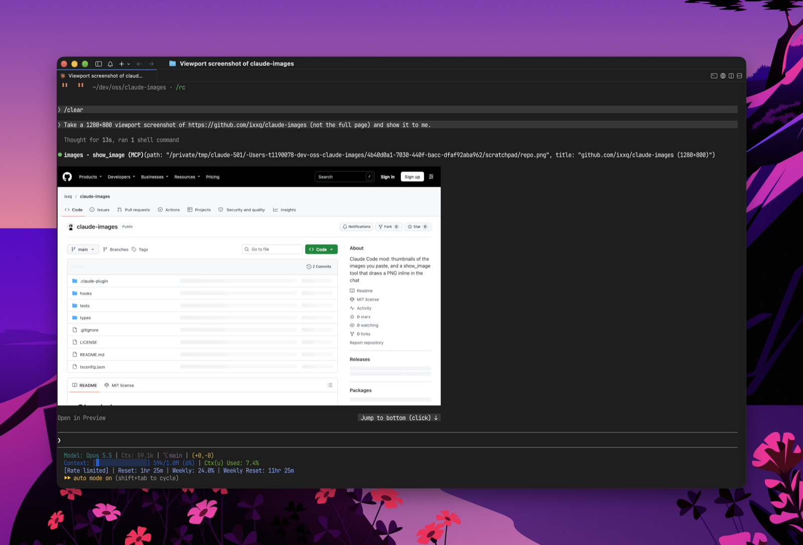
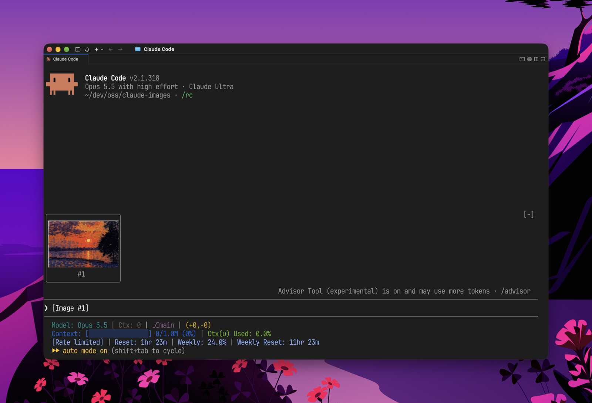

# Claude Images

チャットの中で画像を扱うための Claude Code の mod です。見せる方向と貼る方向の両方に対応しています。



**見せる画像**: この mod は Claude 用に `show_image` というツールを 1 つ登録します。Claude が PNG のパスを渡してこのツールを呼ぶと、ツールの結果行の代わりに画像がインラインで描画され、その下に「Open in Preview」ボタンが付きます。ツールの説明文には、見た目に関わる作業のあとは頼まれなくても使うよう書いてあります。そのため Claude は headless Chrome や Playwright でページのスクリーンショットを撮ったり、チャートやデザインを描いたりしたあと、ファイルを開くよう頼む代わりに結果を見せます。



**貼る画像**: プロンプトに画像を貼り付けると、`[Image #1]` という文字だけのタグの代わりに、入力欄の上にサムネイルが表示されます。タイルの下の番号を押すと、貼り付けた画像を Preview で開きます。

## インストール

Claude Code の中で次を実行します。

```
/plugin install images --marketplace ixxq/claude-images
```

marketplace の追加を `y` で承認し、スコープを選んでから、`/reload-plugins` を実行するか新しいセッションを開始してください。

## できること

- プロンプトの上に、下書きの `[Image #n]` タグ 1 つにつき 1 枚のサムネイルを並べます。高さは 6 行固定で、横に収まらないタイルは `+N` と表示します。帯の高さが足りない端末では帯がスクロールするので、帯に余裕を持たせてください。ステータス行は 4 行より 2 行の方が余裕ができます。
- `show_image(path, title?)`: この mod が Claude に追加するツールです。絶対パスで指定した 2 MiB 以下の PNG を、縦横比を保ったままチャットの幅で描画し、その下に「Open in Preview」を付けます（macOS の `open -a Preview`）。
- それ以外はありません。動画、履歴、テレメトリ、自動更新はなく、全体で 300 行ほどです。

## 対応する端末

画像が描画されるのは、Claude Code 本体の `Image` 要素が画像を描ける端末です。Ghostty、kitty、そして kitty graphics protocol に対応した端末で、Orca も含まれます。それ以外の端末では、画像の代わりに alt テキスト（`[Image #1]`、`[image: title]`）が表示されます。

PNG 以外の貼り付け（たとえばブラウザからの JPEG）は `sips` で一度だけ PNG に変換するため、サムネイルの表示には macOS が必要です。Linux ではそのタイルに `no preview` と表示されます。

## 開発

```
claude plugin validate .
claude plugin test .
```

フォルダから直接インストールすると、編集内容が `/reload-plugins` で反映されます。

```
claude plugin marketplace add ~/dev/oss/claude-images
claude plugin install images@claude-images
```

## ライセンス

MIT
