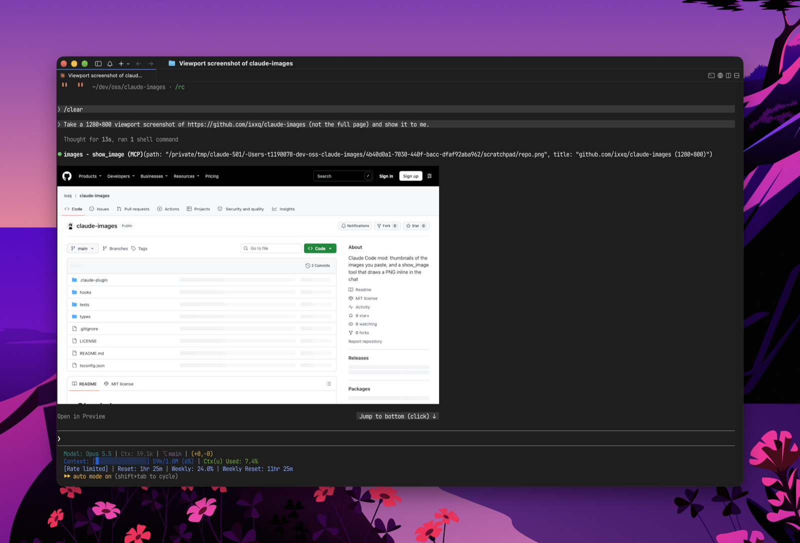
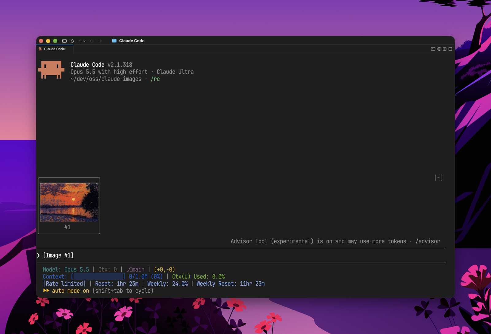

# Claude Images

English | [日本語](README.ja.md)

A Claude Code mod for working with images directly in chat. It lets Claude show you images inline and gives you thumbnail previews for images you paste.



**Images from Claude**: This mod adds a tool called `show_image` to Claude. When Claude invokes it with a path to a PNG, the image renders right in the chat instead of a standard tool output line, accompanied by an "Open in Preview" button. The tool's description prompts Claude to use it automatically after visual work, even if you didn't ask. So after taking a screenshot (via headless Chrome or Playwright) or generating a chart or design, Claude shows you the result on the spot instead of telling you to open the file yourself.



**Pasted images**: Paste an image into your prompt, and along with the usual `[Image #1]` tag, you'll get an actual thumbnail preview right above the input box. Clicking the number below a thumbnail opens the full image in Preview.

## Installation

Run this inside Claude Code:

```
/plugin install images --marketplace ixxq/claude-images
```

Type `y` to approve adding the marketplace, pick a scope, and then either run `/reload-plugins` or restart your session.

## Details

- Thumbnails: 6 lines tall, and anything that overflows horizontally collapses into a `+N` badge. Make sure your terminal has enough vertical clearance so the thumbnail strip doesn't scroll off-screen.
- `show_image(path, title?)`: Takes an absolute path to a PNG (up to 2 MiB) and fits it to the chat width while keeping the aspect ratio intact. "Open in Preview" uses macOS `open -a Preview`.
- That's it. No video, no history tracking, no telemetry, no auto-updates. The entire codebase is roughly 300 lines.

## Terminal support

Images work in any terminal that supports Claude Code's native `Image` component: Ghostty, kitty, Orca, and other terminals with kitty graphics protocol support. On unsupported terminals, you'll see fallback alt text instead (like `[Image #1]` or `[image: title]`).

Non-PNG formats (like JPEGs copied from a browser) are converted to PNG once, when pasted, using macOS's built-in `sips` utility. Because of this, pasted thumbnails require macOS; on Linux, they will show as `no preview`.

## Development

```
claude plugin validate .
claude plugin test .
```

To live-reload your changes with `/reload-plugins`, install directly from your local directory:

```
claude plugin marketplace add ~/dev/oss/claude-images
claude plugin install images@claude-images
```

## License

MIT
